# SOC-LAB - Detection, investigation et reponse aux incidents

Laboratoire SOC local base sur **Wazuh, Shuffle, TheHive et Cortex** pour la collecte des logs, la detection des menaces, l'enrichissement des alertes et la gestion des incidents.

Les tests de detection reposent sur des simulations Atomic Red Team associees aux techniques MITRE ATT&CK.

## Sommaire

1. [Presentation du projet](#1-presentation-du-projet)
2. [Architecture et environnement du SOC](#2-architecture-et-environnement-du-soc)
3. [Outils et technologies](#3-outils-et-technologies)
4. [Fonctionnement du SOC](#4-fonctionnement-du-soc)
5. [Supervision et detection des menaces](#5-supervision-et-detection-des-menaces)
6. [Automatisation et playbooks SOAR](#6-automatisation-et-playbooks-soar)
7. [Gestion des alertes et reponse aux incidents](#7-gestion-des-alertes-et-reponse-aux-incidents)
8. [Simulation d'attaques et scenarios de validation](#8-simulation-dattaques-et-scenarios-de-validation)
9. [Resultats, limites et ameliorations](#9-resultats-limites-et-ameliorations)
10. [Documentation technique](#10-documentation-technique)
11. [Competences developpees](#11-competences-developpees)
12. [Ressources et references](#12-ressources-et-references)

---

## 1. Presentation du projet

### 1.1 Contexte

Le projet regroupe les principaux composants d'un Security Operations Center (SOC) dans un environnement de laboratoire.

Wazuh assure la collecte et la detection. Shuffle gere l'orchestration des traitements, Cortex l'analyse des observables et TheHive le suivi des alertes et des cas.

Le perimetre couvre principalement un endpoint Linux et plusieurs scenarios de test. Les validations Windows et MITRE Caldera restent a completer.

### 1.2 Objectif general

Mettre en place une chaine de traitement allant de la collecte des evenements jusqu'a la creation d'alertes et de cas d'investigation.

La validation porte sur la detection, la transmission des alertes, l'enrichissement et la creation des cas.

### 1.3 Objectifs specifiques

- Centraliser les logs des machines surveillees dans Wazuh
- Utiliser les regles Wazuh pour detecter des comportements suspects
- Creer des playbooks Shuffle pour traiter les alertes
- Utiliser Cortex pour analyser les IP, URL et hash
- Creer et suivre les alertes et les cas dans TheHive
- Faire des tests avec Atomic Red Team puis completer avec MITRE Caldera
- Documenter les configurations, les scenarios et les resultats des tests

## 2. Architecture et environnement du SOC

### 2.1 Architecture du lab

Le deuxieme prototype repartit les services sur deux hotes Docker connectes au meme reseau local. Les echanges entre les stacks passent par les IP des hotes et les ports exposes.

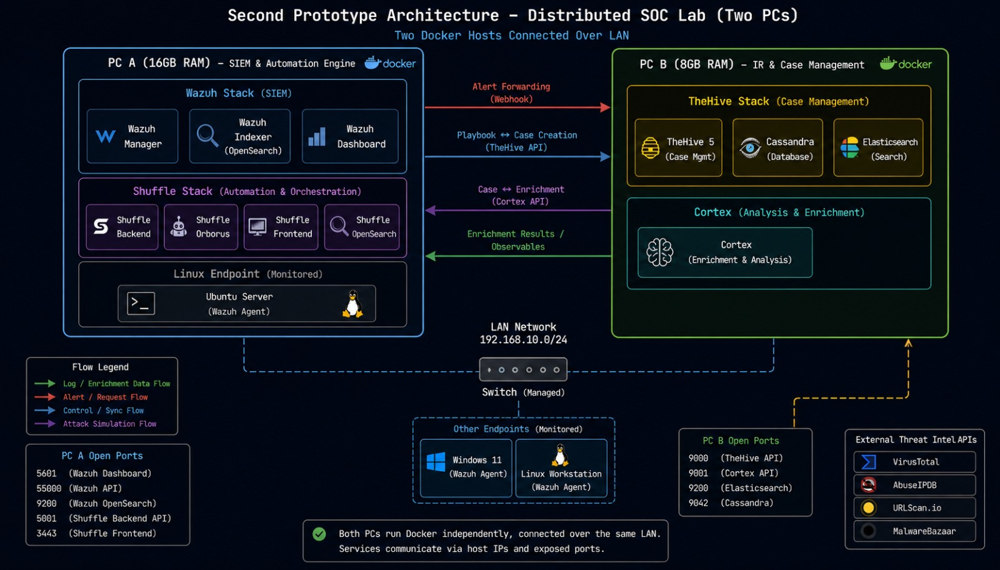

*Architecture distribuee du deuxieme prototype*

| Machine | RAM indiquee | Services |
|---|---|---|
| PC A | 16 Go | Wazuh Manager, Indexer, Dashboard et Shuffle |
| PC B | 8 Go | TheHive, Cassandra, Elasticsearch et Cortex |
| Machines surveillees | Selon la machine | Agent Wazuh sur Linux et Windows dans le schema |

Adressage du schema : `192.168.10.0/24`. Les captures d'execution utilisent un environnement en `10.0.0.x`.

### 2.2 Machine surveillee

| Parametre | Valeur relevee |
|---|---|
| Systeme | Ubuntu 24.04.4 LTS |
| Nom de l'agent | `test_agent` |
| Identifiant | `001` |
| Version de l'agent | `4.9.2` |
| Adresse IP | `10.0.0.3` |
| Statut | Actif |

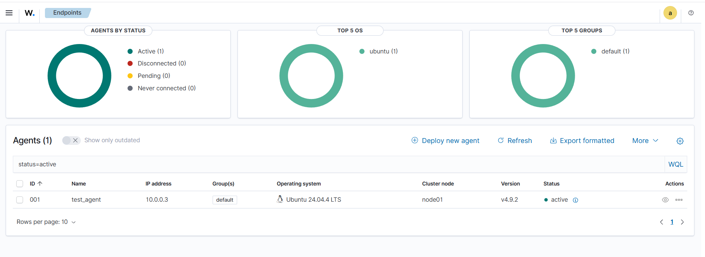

*Etat de connexion de l'agent Ubuntu dans Wazuh*

Les endpoints Windows figurent dans l'architecture cible. La supervision presentee ici concerne l'endpoint Ubuntu.

## 3. Outils et technologies

| Outil | Utilisation dans le projet |
|---|---|
| Wazuh | Collecter les logs et detecter les alertes |
| Shuffle | Automatiser le traitement avec des playbooks |
| TheHive | Regrouper les alertes et suivre les cas |
| Cortex | Analyser les observables comme les IP, URL et hash |
| Docker et Docker Compose | Deployer les services du lab |
| Wazuh Agent | Envoyer les evenements de la machine surveillee |
| Atomic Red Team | Executer des tests d'attaque dans le lab |
| MITRE ATT&CK | Identifier les techniques utilisees dans les tests |
| Sysmon et MITRE Caldera | Outils prevus pour completer le lab |

## 4. Fonctionnement du SOC

### 4.1 Chaine de traitement

```text
Machine surveillee -> Wazuh -> Shuffle
                                |-> Cortex : analyse des observables
                                |-> TheHive : alertes et cas
```

| Etape | Composant | Traitement |
|---|---|---|
| Collecte | Agent Wazuh | Transmission des evenements de l'endpoint au manager |
| Detection | Wazuh Manager | Analyse des evenements et generation d'alertes selon les regles |
| Orchestration | Shuffle | Reception par webhook et extraction des informations utiles |
| Enrichissement | Cortex | Analyse des IP, URL et hash avec les analyseurs disponibles |
| Investigation | TheHive | Centralisation des alertes et creation des cas |

### 4.2 Etat de validation

Les captures couvrent plusieurs executions independantes. La correlation d'un meme evenement sur toute la chaine reste a documenter avec les identifiants et les horodatages.

## 5. Supervision et detection des menaces

### 5.1 Supervision avec Wazuh

La vue Threat Hunting est filtree sur l'agent `001`. Elle presente le volume d'alertes, leur niveau et leur repartition dans le temps. Les groupes visibles incluent `audit`, `local`, `audit_command`, `atomic_red_team` et `syscheck`.

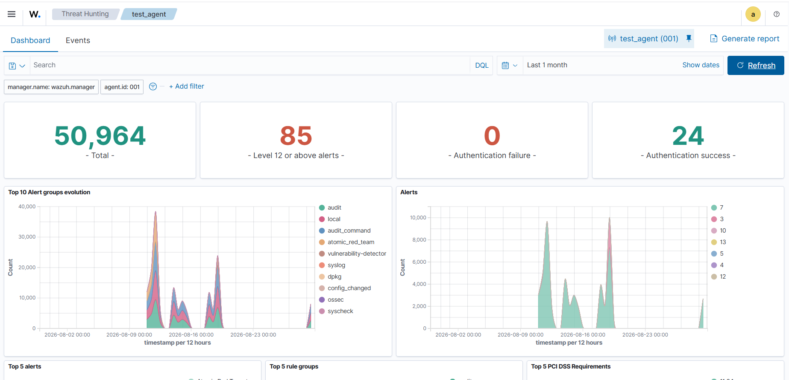

*Threat Hunting - activite de l'agent test_agent sur la periode Last 1 month*

| Indicateur | Valeur affichee |
|---|---|
| Total des alertes | 50 964 |
| Alertes de niveau 12 ou plus | 85 |
| Authentifications echouees | 0 |
| Authentifications reussies | 24 |

Ces compteurs decrivent l'activite sur la periode selectionnee. Ils ne representent pas un taux de detection.

### 5.2 Reception d'une alerte dans Shuffle

Exemple de reception d'une alerte Wazuh par webhook :

| Champ | Valeur |
|---|---|
| Evenement | Creation d'un fichier d'unite systemd |
| Technique associee dans l'alerte | `T1543.002` |
| Regle Wazuh | `100021` |
| Source d'execution Shuffle | `webhook` |
| Statut de l'execution | `FINISHED` |

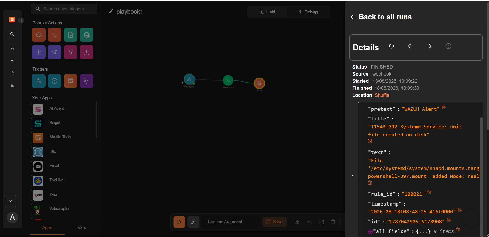

*Donnees de l'alerte Wazuh dans une execution Shuffle terminee*

Les champs recus comprennent le titre, le texte de l'evenement, l'identifiant de regle et l'horodatage. La qualification de l'alerte repose sur l'analyse de ce contexte.

## 6. Automatisation et playbooks SOAR

### 6.1 Playbook Shuffle

Le workflow relie l'entree `Wazuh alert in` a l'etape `Parse alert`, puis aux integrations Cortex et TheHive.

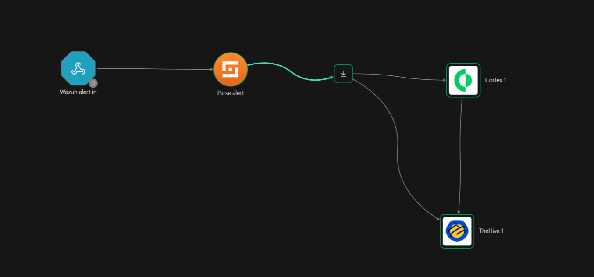

*Organisation du playbook SOC dans Shuffle*

Le parsing prepare les donnees de l'alerte pour les traitements suivants. La validation du playbook s'appuie sur le statut des executions et les sorties de chaque etape.

### 6.2 Enrichissement avec Cortex

Analyseurs disponibles dans l'environnement Cortex :

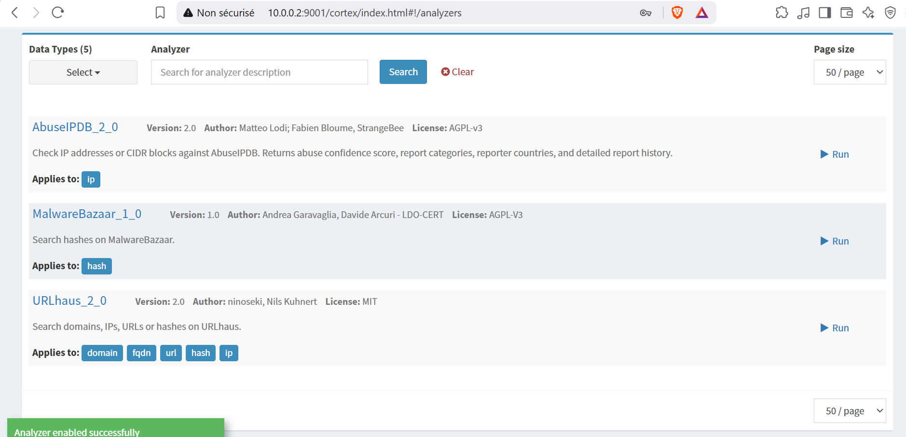

| Analyseur | Donnees analysees |
|---|---|
| AbuseIPDB | Adresses IP |
| MalwareBazaar | Hash de fichiers |
| URLhaus | URL, domaines, IP et hash selon le type accepte |

L'historique contient des jobs URLhaus et AbuseIPDB au statut `Success`, executes avec le compte de service `soc-lab/shuffle-service`.

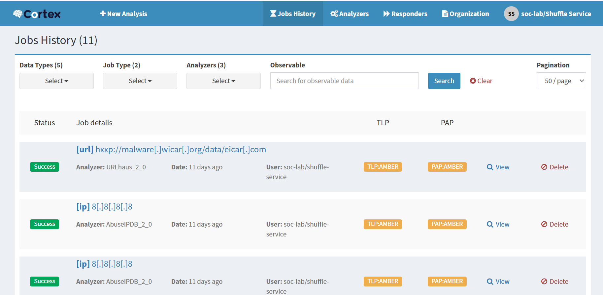

*Exemples de jobs URLhaus et AbuseIPDB termines dans Cortex*

## 7. Gestion des alertes et reponse aux incidents

### 7.1 Alertes dans TheHive

Les alertes sont centralisees dans TheHive avec leur titre, severite, source, reference et tags.

| Alerte presente | Source | Contexte |
|---|---|---|
| Mimikatz Usage Detected on Endpoint | `wazuh_manager` | Tags `credential-dumping`, `mimikatz` et `wazuh` |
| Cron persistence attempt (T1053.003) | `shuffle-lab` | Alerte de test de persistance cron |

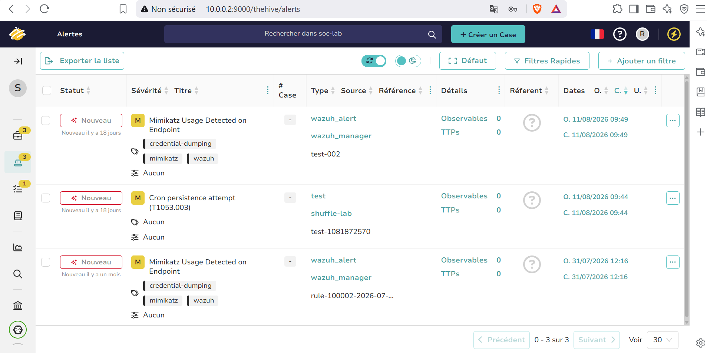

*Liste des alertes dans l'organisation soc-lab*

### 7.2 Exemple de cas

| Champ | Valeur |
|---|---|
| Titre | Cron persistence investigation (T1053.003) |
| Hote mentionne | `bisara` |
| Origine indiquee dans la description | Cas de test cree depuis Shuffle |
| Severite | Moyenne |
| Statut | Nouveau |
| Tags | `T1053.003`, `cron_persistence`, `shuffle-lab` |

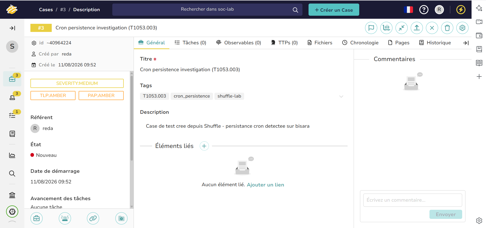

*Cas d'investigation associe au scenario de persistance cron*

La vue affiche zero tache, observable et TTP. Le cas documente la creation initiale de l'investigation, sans suivi complet jusqu'a la cloture.

Les actions de confinement et de remediation restent a valider.

## 8. Simulation d'attaques et scenarios de validation

### 8.1 Tests avec Atomic Red Team

Les simulations Atomic Red Team sont executees sur l'endpoint Linux. Deux tests sont presentes dans le terminal :

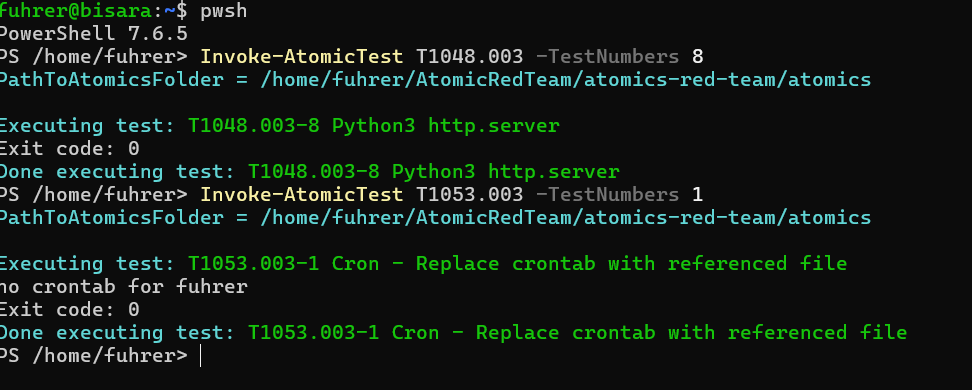

*Execution des tests T1048.003 et T1053.003 sur Linux*

| Technique | Test affiche | Resultat |
|---|---|---|
| T1048.003 | Test 8 - Python3 http.server | Execution terminee avec le code 0 |
| T1053.003 | Test 1 - Cron, remplacement de la crontab | Execution terminee avec le code 0 |

Un code de sortie `0` confirme la fin de l'execution du test. La validation defensive necessite de retrouver l'evenement dans Wazuh et de verifier son traitement dans Shuffle et TheHive.

### 8.2 Validation des scenarios

Pour chaque scenario, les elements a correler sont :

- Technique et numero du test Atomic Red Team
- Hote cible et heure d'execution
- Evenement Wazuh, identifiant de regle et horodatage
- Execution Shuffle et resultat des etapes
- Reference de l'alerte ou du cas TheHive

Cette correlation reste a completer pour les scenarios presentes. Les simulations MITRE Caldera sont prevues dans la suite du projet.

## 9. Resultats, limites et ameliorations

### 9.1 Resultats

Etat des composants d'apres les executions presentees :

- L'agent Ubuntu est actif dans Wazuh et des alertes sont consultables
- Une alerte Wazuh est recue dans Shuffle par webhook
- Cortex execute des analyses avec AbuseIPDB et URLhaus
- Des alertes et un cas de test sont presents dans TheHive
- Les deux tests Atomic Red Team affiches se terminent avec le code 0

### 9.2 Limites rencontrees

Le statut `Success` dans Cortex indique une execution reussie du job. Le rapport URLhaus presente retourne `No results` avec un niveau `info`, soit une absence de correspondance dans la source interrogee. Ce resultat ne suffit pas a qualifier l'observable comme sain.

<details>
<summary>Voir le resultat URLhaus</summary>

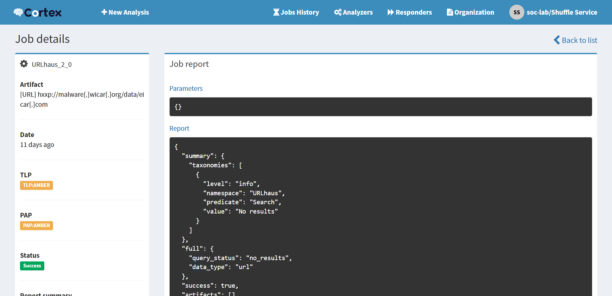

*Rapport URLhaus - execution reussie et recherche sans correspondance*

</details>

- Correlation complete entre les tests et les alertes a documenter
- Cas TheHive a completer avec les taches, observables et TTP
- Delais de detection et de traitement non mesures
- Faux positifs non evalues

### 9.3 Ameliorations prevues

- Documenter un scenario complet du test jusqu'au cas TheHive
- Ajouter les observables, les taches et les preuves dans les cas
- Ajuster les regles Wazuh apres les tests
- Mesurer le temps entre le test et l'arrivee de l'alerte
- Completer les tests sur Windows et avec Caldera
- Ajouter les fichiers de configuration et les exports des playbooks

## 10. Documentation technique

Les captures et le schema d'architecture sont regroupes dans [docs/images](docs/images/).

```text
SOC-PROJECT/
|-- README.md
|-- docs/
    |-- images/
```

Elements a ajouter pour reproduire le deploiement :

- Fichiers Docker Compose et parametres reseau
- Configuration des agents et regles Wazuh
- Exports des playbooks Shuffle
- Configuration des integrations TheHive et Cortex sans secrets
- Fiches de test et resultats associes

## 11. Competences developpees

- Architecture d'un laboratoire SOC distribue sur deux hotes
- Collecte et analyse des evenements Linux avec Wazuh
- Integration par webhook et orchestration avec Shuffle
- Analyse d'observables avec Cortex
- Gestion des alertes et creation de cas dans TheHive
- Simulation de techniques MITRE ATT&CK avec Atomic Red Team

## 12. Ressources et references

- [Wazuh - Documentation](https://documentation.wazuh.com/current/index.html)
- [Shuffle - Documentation](https://shuffler.io/docs)
- [TheHive - Documentation](https://docs.strangebee.com/thehive/overview/)
- [Cortex - Documentation](https://docs.strangebee.com/cortex/)
- [Docker Compose - Documentation](https://docs.docker.com/compose/)
- [Atomic Red Team - Documentation](https://www.atomicredteam.io/docs/atomic-red-team)
- [MITRE ATT&CK - Referentiel des techniques](https://attack.mitre.org/)
